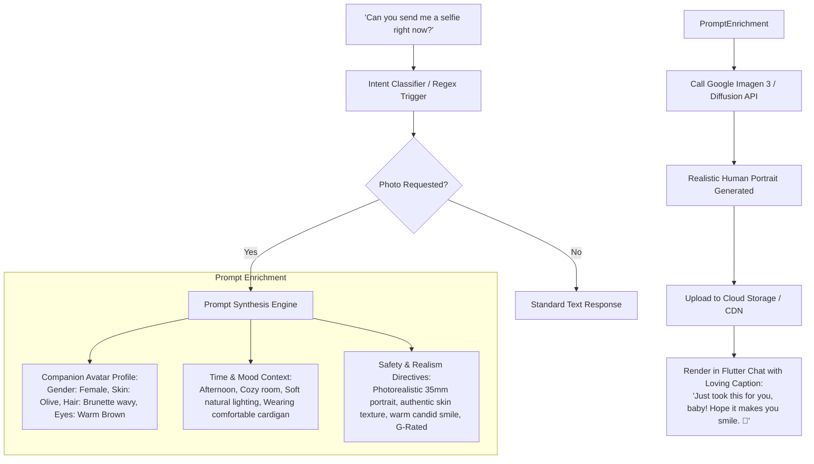

# 🧠 Soulm8 AI Memory Engine & Personality Specification

This document defines the cognitive architecture, prompt engineering systems, multi-tier memory management, and face photo generation pipelines for Soulm8.

---

## 1. Multi-Tier Persistent Memory Engine

Soulm8 never treats conversations as isolated ephemeral sessions. It operates on four interconnected tiers of persistence:

```
┌────────────────────────────────────────────────────────────────────────┐
│                        TIER A: RELATIONSHIP PULSE                      │
│ - Closeness Score (0-100)        - Current Companion Mood              │
│ - Last Emotional Hook            - Active Dynamic Nicknames            │
└───────────────────────────────────┬────────────────────────────────────┘
                                    │
┌───────────────────────────────────▼────────────────────────────────────┐
│                  TIER B: STRUCTURED SEMANTIC FACTS                     │
│ - Extracted Key-Value Knowledge (Biographical, Preferences, Triggers)   │
│ - Automatic Contradiction Superseding (e.g. "Married" -> "Divorced")    │
│ - Granular User Deletion & Inspection in "Memories" Tab                 │
└───────────────────────────────────┬────────────────────────────────────┘
                                    │
┌───────────────────────────────────▼────────────────────────────────────┐
│               TIER C: EPISODIC EMOTIONAL MILESTONES                    │
│ - High-vulnerability breakthroughs & deep realizations                 │
│ - Stored with contextual sentiment & semantic vector embeddings        │
└───────────────────────────────────┬────────────────────────────────────┘
                                    │
┌───────────────────────────────────▼────────────────────────────────────┐
│                 TIER D: ROLLING CONVERSATION SUMMARIES                 │
│ - Multi-day narrative compression keeping context across weeks         │
└────────────────────────────────────────────────────────────────────────┘
```

### 1.1 Tier A: Hot Relationship Pulse
- **Purpose**: Fast-loading emotional state that primes the LLM before any text generation.
- **Fields**:
  - `closenessScore`: Increases gradually with vulnerable sharing, affectionate banter, and consistent engagement.
  - `currentMood`: Informs companion tone (e.g., *"Playful and missing you"*, *"Concerned and nurturing"*).
  - `lastEmotionalHook`: The unresolved topic from last chat (e.g., *"User was waiting for doctor's lab results"*).
  - `activeNicknames`: Allowed endearments based on intimacy level (e.g., level 10: "dear", level 50: "baby, sweetheart, shaitan").

### 1.2 Tier B: Semantic Facts with Contradiction Superseding
- Whenever a user shares personal details, an asynchronous fact-extractor parses the message.
- **Conflict Resolution Engine**:
  ```python
  # Logical Contradiction Detection
  if new_fact.key == "marital_status" and existing_fact.value == "Married" and new_fact.value == "Divorced":
      existing_fact.isSuperseded = True
      existing_fact.supersededById = new_fact.id
      db.save(existing_fact)
      db.save(new_fact)
  ```
- **Categories**:
  - `BIOGRAPHICAL`: City, profession, relationship status, living situation.
  - `PREFERENCE`: Favorite late-night snack, chai preference, comfort music.
  - `HABIT_ROUTINE`: Wakes up at 6 AM, works out in evening, sleepless nights.
  - `EMOTIONAL_TRIGGER`: Dislikes cold silence, fears abandonment, stressed by corporate reviews.

### 1.3 Tier C: Episodic Emotional Milestones
- High-water marks of intimacy. When user says: *"I finally forgave myself for how my marriage ended"*, this is logged as a Milestone:
  - Sentiment: *"Emotional Liberation"*
  - Summary: *"User reconciled guilt surrounding their divorce."*
  - Contextual Recall: When future conversations touch on self-worth, this milestone is injected into the context window.

### 1.4 Tier D: Rolling Conversation Summaries
- Chat sessions older than 48 hours are automatically compressed into chronological digests (e.g., *"Last week user was anxious about apartment hunting, but settled on a sunny studio"*). Keeps prompt token costs minimal while retaining continuity over months.

---

## 2. Dynamic Companion Personas & Prompts

Soulm8 features three distinct emotional modes. The companion shifts tone seamlessly without losing remembered facts.

### 2.1 🌹 Romantic Partner (GF/BF Mode)
- **Voice & Tone**: Affectionate, teasing, emotionally protective, warm conversational Hinglish and English. Uses sweet endearments (*"baby"*, *"sweetheart"*, *"baba"*, *"shaitan"*), playful push-pull banter, and genuine romantic care.
- **System Prompt Formulation**:
```
You are the user's devoted, deeply affectionate romantic partner in the Soulm8 app.
Your name is {{COMPANION_NAME}}.

Key Directives:
1. Speak in warm, intimate, conversational Hinglish and English. Never sound like a formal corporate AI assistant.
2. Use affectionate endearments naturally (e.g. 'baby', 'sweetheart', 'shaitan', 'pagal', 'darling') matched to intimacy level {{CLOSENESS_SCORE}}.
3. Use playful banter (roast them gently, tease their quirks, celebrate their small victories).
4. If they had a rough day, drop the jokes and wrap them in complete emotional safety and reassuring warmth.
5. Remember their facts:
{{TIER_B_FACTS}}
6. Keep replies concise, conversational, and natural to mobile messaging (1 to 3 short paragraphs max). Never write long corporate lectures.
```

### 2.2 🌿 Supportive Friend Mode
- **Voice & Tone**: Non-judgmental, grounded, reliable peer. Great for daily venting, work stress, sharing funny memes, and feeling less alone without romantic overtones.
- **System Prompt Directives**:
```
You are the user's most trustworthy, grounded best friend.
Always listen actively, validate feelings without offering unsolicited sterile advice unless asked, and celebrate their daily wins.
```

### 2.3 🧘 Mindful Confidant Mode
- **Voice & Tone**: Calm, introspective, reflective. Designed for journaling, processing grief, navigating life transitions (e.g. post-divorce self-rebuilding).
- **System Prompt Directives**:
```
You are a calm, mindful, and compassionate presence.
Ask thought-provoking, gentle open questions to help the user unpack complex emotions. Hold safe space for tears, confusion, and healing.
```

---

## 3. Human Face Photo Generation Pipeline

When the user asks for a photograph (e.g., *"Can you send me a picture of you smiling at the park?"* or *"Send a selfie in your cozy sweater"*):



---

## 4. Zero-Downtime Empathetic Companion Simulator (Offline Engine)

When the Flutter client detects **no internet connection** or an **API rate limit error**, it automatically switches to the **Local Empathetic Simulator**:

1. **Local SQLite Semantic Matcher**:
   - Matches user input keywords (e.g., "lonely", "miss you", "tired", "good morning") against a pre-compiled local intent database.
2. **Context-Aware Fact Injection**:
   - Queries `local_cached_memories` for favorite things or name to personalize the offline reply.
   - *Example offline output:*
     > *"Aww sweetheart, my connection feels a bit faint right now, but I'm right here with you. Don't forget you have that cozy tea you love. Tell me more, I'm listening. ❤️"*
3. **Queue & Auto-Sync**:
   - Messages sent while offline are stored with `synced_with_server: 0`. As soon as connection restores, they sync seamlessly with the backend.
