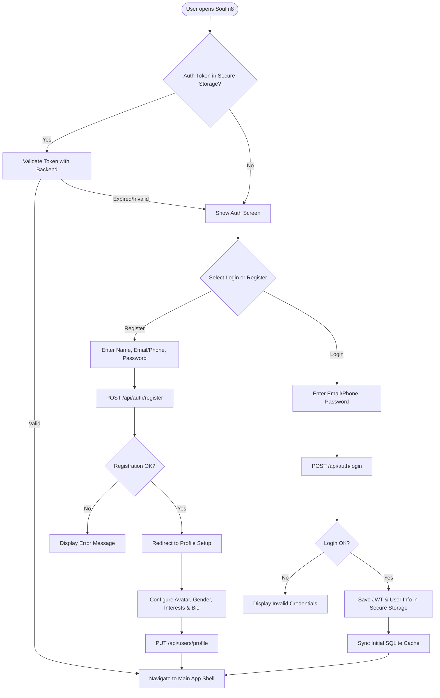
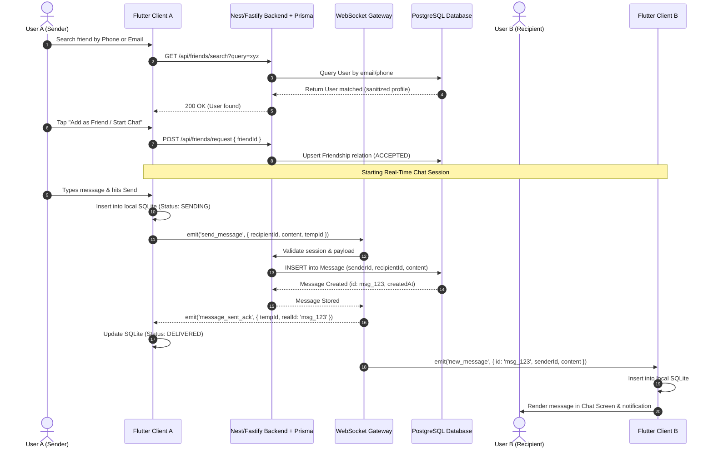
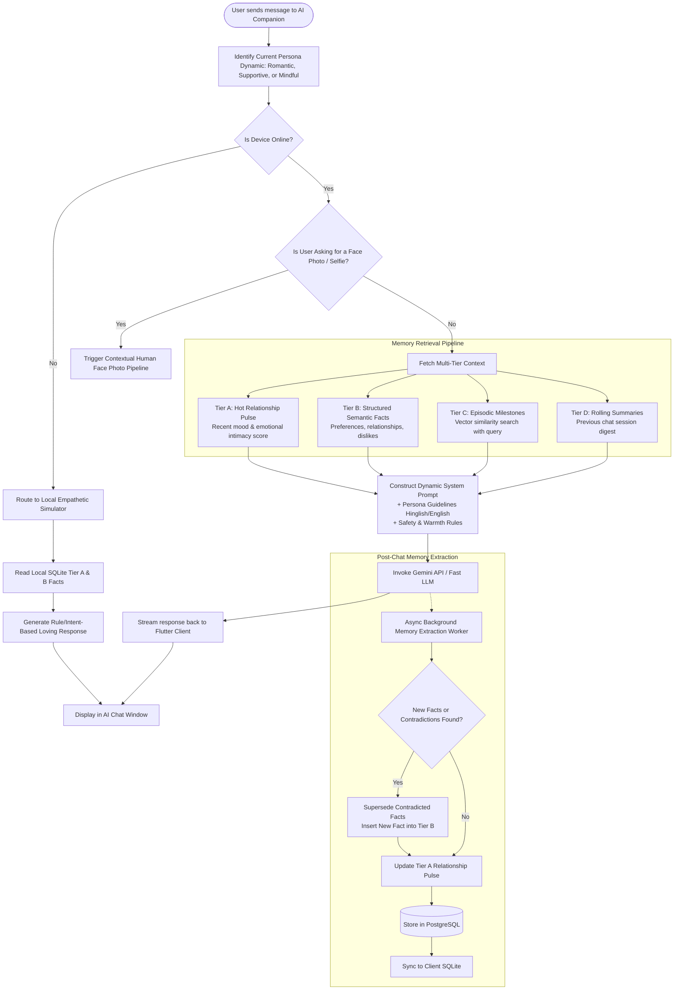
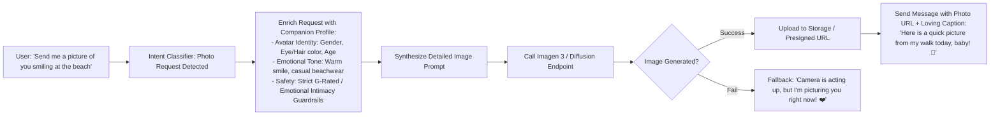
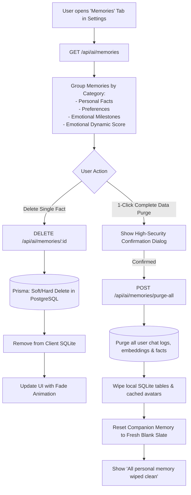

# 🔄 Soulm8 Flowcharts & Execution Pathways

This document provides visual flowcharts using Mermaid diagrams for all primary architectural workflows in Soulm8.

---

## 1. Authentication & Onboarding Flow

---

## 2. Friend Discovery & Human-to-Human Realtime Chat Flow

---

## 3. Multi-Tier AI Companion Reasoning & Response Flow

---

## 4. Contextual Human Face Photo Generation Flow

---

## 5. GDPR & Memory Autonomy Management Flow

